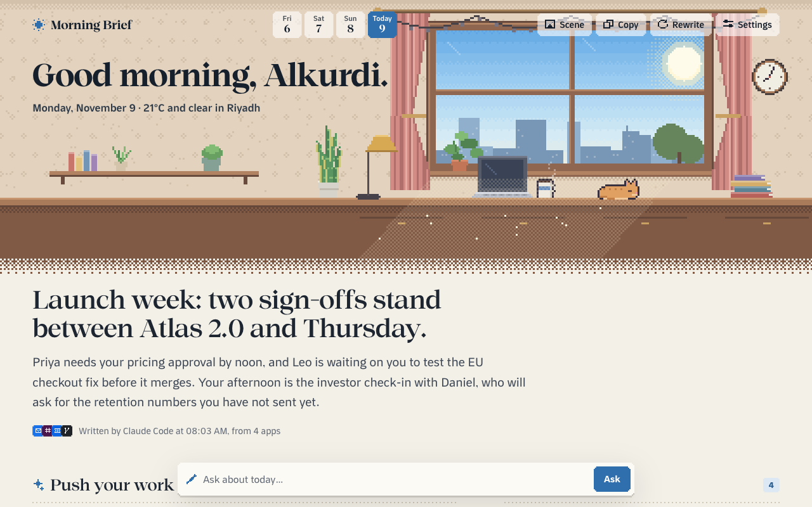
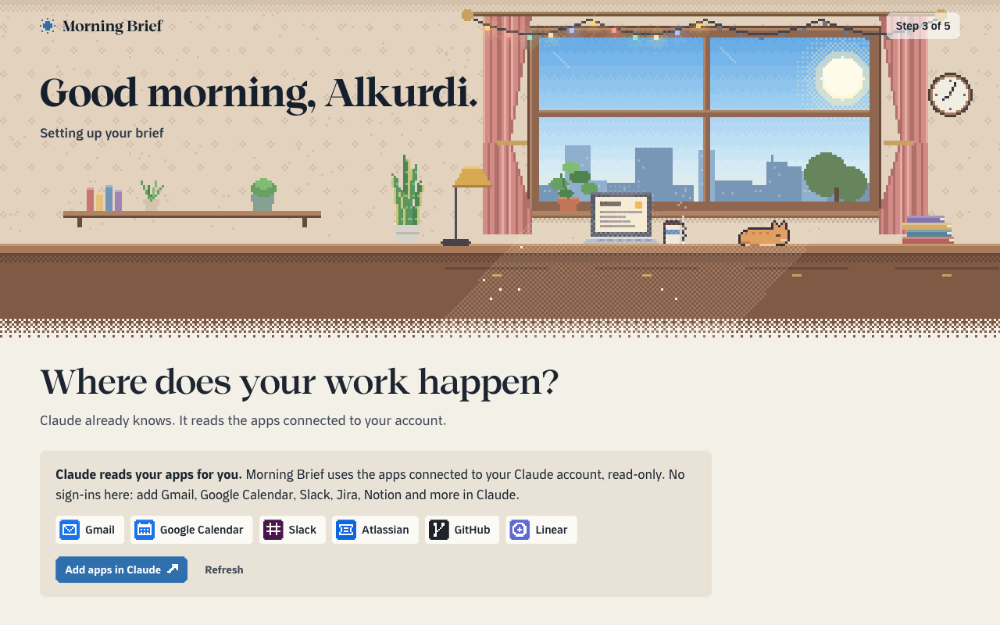

# Morning Brief

A browser extension that writes your morning brief from the apps connected to your Claude account: to-dos, updates, your day, and who's waiting on you. English and Arabic.

| English | العربية |
|---|---|
|  |  |
|  |  |

## Install

Needs a Mac, Chrome, Node 18+, and Claude Code signed in to a Pro or Max plan. Connect your apps at claude.ai/settings/connectors.

Paste this into Claude Code:

````text
Install the Morning Brief browser extension for me on this Mac. Run each step, stop and tell me if one fails.

1. Check `node --version` is 18 or newer. If Node is missing or older, install the current LTS (Homebrew `brew install node` if brew exists, otherwise tell me to get it from https://nodejs.org) and stop.
2. Check `claude --version`. If missing, run `npm install -g @anthropic-ai/claude-code`. Then run `claude auth status --json`; if it isn't logged in, or isn't on a Claude Pro or Max plan, tell me to run `claude auth login` myself and stop.
3. Clone it into ~/morning-brief-extension (if that folder already exists, `git -C ~/morning-brief-extension pull` instead). If `gh auth status` shows I'm signed in, use `gh repo clone MohAlkurdi/morning-brief-extension ~/morning-brief-extension`; otherwise use `git clone https://github.com/MohAlkurdi/morning-brief-extension.git ~/morning-brief-extension`. If cloning fails for access, tell me to ask Mohammed for access to the repo and stop.
4. Work out the extension id Chrome will give that folder:
   cd ~/morning-brief-extension && node -e 'const h=require("crypto").createHash("sha256").update(process.argv[1]).digest("hex").slice(0,32);console.log([...h].map(c=>String.fromCharCode(97+parseInt(c,16))).join(""))' "$PWD"
5. Install the helper with that id: `sh ~/morning-brief-extension/host/install.sh <id>`.
6. Tell me to finish in Chrome: open chrome://extensions, turn on Developer mode, press Load unpacked and pick ~/morning-brief-extension (exactly that folder, or the id won't match). In the setup page that opens, choose Claude and press Check connection; skip Download helper, it's already installed. Remind me to connect my apps at https://claude.ai/settings/connectors.
````

Or by hand: clone the repo, then in `chrome://extensions` turn on Developer mode, press **Load unpacked** and pick the folder. Setup walks you through the helper.

## How it works

Claude Code on your Mac writes the brief, on your own plan. A small helper connects it to the extension. It can only read your apps: shell, files and web tools are off, and `host/guard.mjs` blocks any connector tool that could send or change something.

## Develop

```
cd tools && npm install
node shots.mjs ../store/screenshots store   # screenshots
node record.mjs --shots                     # walk the whole journey
node guard-test.mjs                         # what the guard allows
sh pack.sh                                  # dist/ zip for the store
```

## License

MIT. See [LICENSE](LICENSE).
